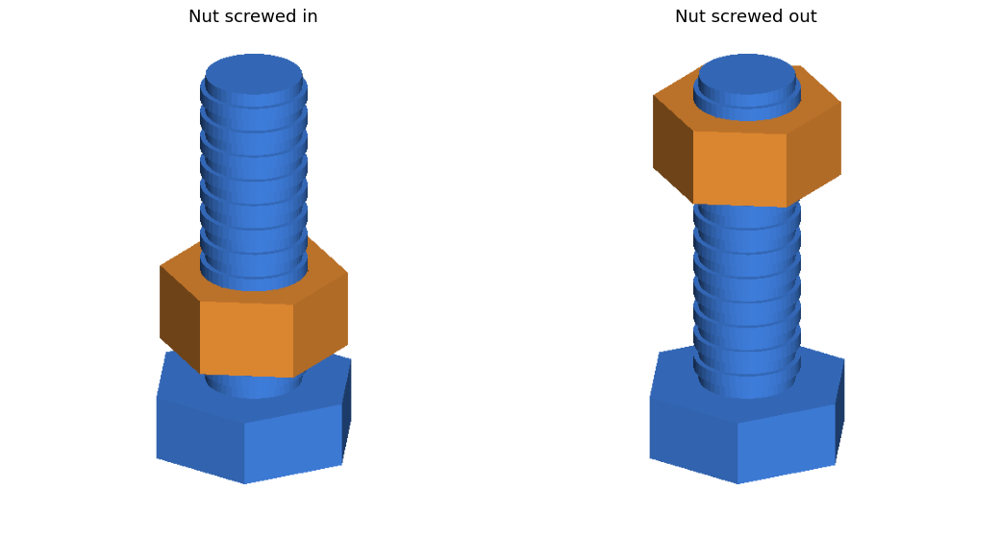
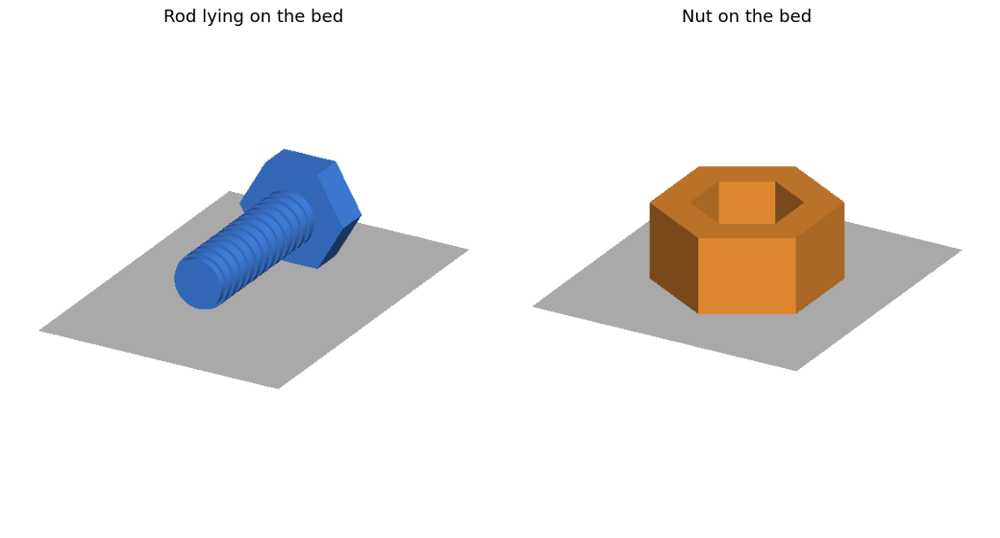

# z-renderer

Render STL / OBJ meshes (and FreeCAD STEP/FCStd models) to PNG preview images with a
tiny **numpy z-buffer rasterizer**. No OpenGL, no display, no GPU – it runs anywhere
numpy and matplotlib run (servers, CI, a Raspberry Pi).

Handy for documenting 3D-printable parts: multi-view figures, assembled vs. exploded
states, or parts lying on the print bed.




## Install

```bash
pip install git+https://github.com/Puding07/z-renderer.git
# or, from a clone:
pip install -e .
```

Requires Python ≥ 3.10, `numpy` and `matplotlib`.

## Command line

```bash
# one model, default view (elev 30°, azim -55°)
zrender part.stl -o part.png

# several models in one scene, each with its own color
zrender screw.stl nut.stl --color "#4080e0" --color 230,140,50 -o assembly.png

# side-by-side panels with titles, on a print bed
zrender part.stl --view 30,-55 --view 15,-120 --title Front --title Side --bed -o views.png

# rotate before rendering (axis x,y,z + degrees), bigger image
zrender part.stl --rotate 1,0,0,90 --size 1000x800 -o lying.png
```

`python -m zrenderer ...` works too, without installing the script.

| option | meaning |
|---|---|
| `--view ELEV,AZIM` | camera in degrees; repeat for more panels |
| `--title TEXT` | panel title, one per `--view` |
| `--color C` | per model, `#rrggbb` or `r,g,b` (0–1 or 0–255) |
| `--bed` | draw a grey plate under the lowest point |
| `--rotate AX,AY,AZ,DEG` | rotate all models about the origin (repeatable) |
| `--size WxH` | panel size in pixels (default 560x560) |
| `--background C` | background color |
| `--scene FILE` | render a JSON scene file (see below); `-o` is then the output dir |

## Scene files

For repeatable documentation images, describe models and figures in JSON and run
`zrender --scene scene.json`. Paths are relative to the scene file.

```json
{
  "output_dir": "out",
  "defaults": { "width": 560, "height": 560, "elev": 25, "azim": -55 },
  "models": {
    "rod": { "file": "rod.stl", "color": "#4080e0" },
    "nut": { "file": "nut.stl", "color": [0.90, 0.55, 0.20] },
    "rod_lying": { "file": "rod.stl", "transform": [{ "rotate": { "axis": [1, 0, 0], "angle": 90 } }] }
  },
  "figures": [
    { "output": "assembly.png", "panels": [
        { "parts": ["rod", "nut"], "title": "Screwed in" },
        { "parts": ["rod", { "model": "nut", "transform": [{ "translate": [0, 0, 22] }] }],
          "title": "Screwed out" } ] },
    { "output": "bed.png", "bed": true, "panels": [ { "parts": ["rod_lying"] } ] }
  ]
}
```

- **models** – `file` (`.stl`, `.obj`, `.json`), optional `color`, `transform`, and `key`
  (which mesh to take from a multi-mesh JSON; defaults to the model name).
- **figures** – one PNG each: `output`, `panels`, plus any of `width`, `height`, `elev`,
  `azim`, `bed`, `dpi`, `title_size`, `background` (overriding `defaults`).
- **panels** – `parts` (model names, or `{"model", "transform", "color"}`), `title`,
  `elev`, `azim`, `bed`.
- **transform** – list applied in order: `{"translate": [x,y,z]}`,
  `{"rotate": {"axis": [x,y,z], "angle": deg, "center": [x,y,z]}}`, `{"scale": f}`.

Full examples: [`examples/demo`](examples/demo) (run `python examples/demo/make_meshes.py`
to regenerate its STLs) and [`examples/freecad`](examples/freecad).

## FreeCAD models (STEP / FCStd)

`tools/freecad_export.py` tessellates every solid into a multi-mesh JSON that scene
files can reference. It needs FreeCAD's Python modules (`/usr/lib/freecad/lib` and
other common locations are found automatically):

```bash
python3 tools/freecad_export.py spacer.step mesh.json --names screw,nut --tol 0.02
zrender --scene examples/freecad/scene.json
```

Without `--names`, FCStd solids are named after their object labels, STEP solids
`solid0`, `solid1`, …

## Python API

```python
import zrenderer as z

screw = z.load("screw.stl")                     # (N, 3, 3) triangle array
nut = z.translate(z.load("nut.stl"), [0, 0, 10])
img = z.render([(screw, (0.25, 0.5, 0.88)), (nut, z.parse_color("#e68c33"))],
               elev=15, azim=-55, bed=False, width=800, height=600)
z.save_image("out.png", img)

z.figure("views.png", [
    {"parts": [(screw, (0.25, 0.5, 0.88))], "title": "Top", "elev": 60},
    {"parts": [(screw, (0.25, 0.5, 0.88))], "title": "Side", "elev": 0, "azim": -90},
])
```

## How it works

Orthographic camera from elevation/azimuth, two-sided Lambert shading with one
camera-relative and one world-space light, and a per-triangle barycentric rasterizer
writing into a z-buffer. It is pure Python/numpy, so expect roughly a few seconds per
10k triangles per panel – fine for docs, not for animation. Use a coarser tessellation
(`--tol`) if renders are slow.

## License

MIT
